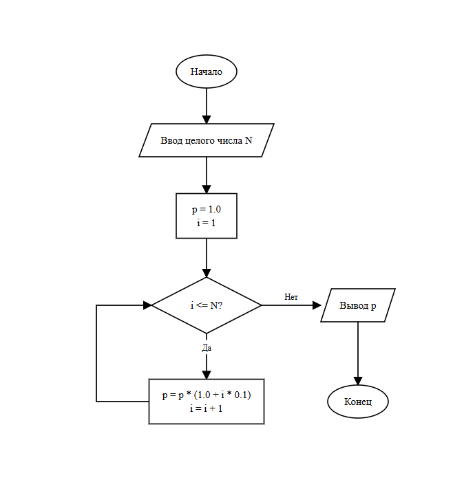

# Домашнее задание к работе 8

## Условие задачи

Вычислите для целого N, заданного пользователем, значение произведения:
1,1 · 1,2 · 1,3 · … · (1 + N · 0,1)

## 1. Алгоритм и блок-схема

### Алгоритм
1. Начало
2. Объявление переменных: целое число `n` — количество сомножителей, вещественное число `p = 1.0` — переменная для накопления произведения, целое число `i = 1` — счётчик цикла
3. Ввод значения `n` с клавиатуры
4. Проверка условия цикла: пока `i <= n`:
   - Накопление произведения: `p = p * (1.0 + i * 0.1)`
   - Инкремент счётчика: `i = i + 1`
5. Вывод полученного значения произведения `p` на экран
6. Завершение работы программы
7. Конец

### Блок-схема


## 3. Результаты работы программы

```
Введите N: 4
Результат: 2,4024
```

## 4. Информация о разработчике

Азиханов Дамир, бТИИ-262
